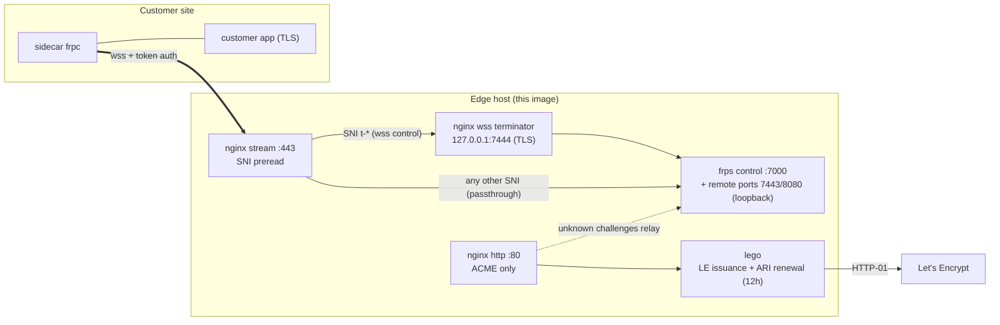

# edge-proxy

[](https://github.com/sr1ch1/edge-proxy/actions/workflows/image.yml)
[](LICENSE)
[](https://github.com/sr1ch1/edge-proxy/pkgs/container/edge-proxy)
[](https://github.com/sr1ch1/edge-proxy/pkgs/container/edge-proxy)
[](Dockerfile)

Single-image edge proxy that terminates customer reverse tunnels ([frp](https://github.com/fatedier/frp)) on one public host **per customer**, with automatic Let's Encrypt certificates. Built to run untrusted-adjacent: non-root, read-only rootfs, capability-dropped, fully pinned dependencies, signed releases.

A sidecar (`frpc`) on the customer's network dials **out** over a `wss://` control channel; the edge proxy multiplexes that channel and passthrough application traffic on a single public `:443` by SNI. No inbound connectivity to the customer site is required.

**Single-tenant by design — not a multi-tenant platform.** One customer = one host, one container, one cert, one token. Target fleet size is up to ~250 customers; see [Scope and design limits](#scope-and-design-limits) before deploying.

## Architecture



- **`:80`** serves only the ACME HTTP-01 webroot. Challenges for unknown names relay through the tunnel to the sidecar's own ACME responder (with a trusted `X-Forwarded-For`).
- **`:443`** is TLS passthrough with SNI preread: `t-*` names go to the in-container nginx TLS terminator (`wss` control channel → frps); everything else passes straight through to the sidecar's own TLS listener via an frps remote port. The `t-*` route is **gated on a CA-signed cert** — until lego has installed one, `t-*` connections are refused at the TCP layer and the per-container bootstrap placeholder is never served. The gate also closes at runtime if the served cert expires while issuance keeps failing, and reopens on the next successful renewal — refused beats a handshake that must fail.
- **lego** (v5, ARI-driven) obtains and renews the `t-*` certificate every 12 h and hot-reloads nginx. Before first issuance a per-container self-signed placeholder lets nginx start (its config needs cert files) but is never routed to a client.

## Scope and design limits

This image is deliberately **not** a shared multi-tenant terminator. The
operational unit is one customer: one edge host (a small VM suffices — the
container is capped at 256 MB / 64 pids), owning that host's `:80`/`:443`,
with its own `DOMAIN` A record, certificate, and token. Isolation between
customers is physical (separate hosts), not configurational.

The numbers that follow from that:

| Limit | Value | Consequence |
|---|---|---|
| Fleet size | up to ~250 customers | Per-customer host + container + cert + DNS record is the unit of operation. Beyond a few hundred customers this shape stops paying; you want a multi-tenant frps front-end, which this image intentionally is not. |
| Concurrent connections per customer | 1024 | `worker_connections` with a single nginx worker, shared by `:443` (control channel **and** app passthrough) and `:80`. The sidecar holds 1–2 long-lived connections; the rest is headroom for app clients. Long-lived app connections (DB sessions, websockets, MQTT) count against it. |
| Per-IP connections | 20 (tunable) | `limit_conn` on `:443` (`edgeconn`) and `:80` (`httpconn`) in `nginx.conf` — DoS headroom sized for the sidecar, but it also caps app passthrough connections per source IP as seen at the edge, so clients behind one NAT (office, mobile CGNAT) share the budget. Raise the zone limits in `nginx.conf` and rebuild the image if an app needs more concurrent connections from a single IP. |
| Apps per customer | one passthrough target | Any non-`t-*` SNI routes to the single frps remote port (`7443`); the edge never sees app plaintext and does no vhost validation. Unknown-host rejection is the customer app's job. |

If you need thousands of tenants, per-customer isolation on shared hardware,
or multiple app frontends per customer behind one edge, this is the wrong
shape — deliberately.

## Runtime parameters

| Variable | Source | Description |
|---|---|---|
| `DOMAIN` | env (required) | Control hostname, `t-<customer-id>.<integrator-domain>`. Its A record must point at this host **before** first start (HTTP-01). Must match the `t-*` SNI route. |
| `ACME_EMAIL` | env (required) | Let's Encrypt registration contact. |
| `FRP_TOKEN_FILE` | env (optional, default `/run/secrets/frp_token`) | Path to the per-customer shared secret. |

The token is **file-only**: the entrypoint refuses to start if `FRP_TOKEN` appears in the environment (it is exposed via `docker inspect` and `/proc/*/environ`). Token requirements: ≥ 32 characters, ≥ 8 distinct characters, restricted ASCII charset. Generate it randomly:

```sh
openssl rand -base64 32 > frp_token
```

## Deployment

`docker-compose.yml` encodes every runtime requirement as enforced configuration (read-only rootfs, `--tmpfs /tmp`, `cap_drop ALL` + `NET_BIND_SERVICE`, `no-new-privileges`, pid/memory/log limits). It is **the only supported way to run this image** — a bare `docker run` silently drops the sandboxing (the entrypoint fails closed on the tmpfs requirement only).

```sh
# 1. Host-side preparation (runtime uid/gid is 10001)
mkdir -p acme-webroot certs
chown 10001:10001 acme-webroot certs && chmod 700 certs
openssl rand -base64 32 > frp_token
chown root:10001 frp_token && chmod 640 frp_token

# 2. Start
DOMAIN=t-<customer-id>.<integrator-domain> ACME_EMAIL=ops@example.com \
  docker compose up -d
```

### Sidecar (frpc) trust contract — required

The `wss` control channel has no server authentication beyond TLS, and frp's client defaults defeat it (`InsecureSkipVerify=true` when no CA file is set). The sidecar **must**:

```toml
transport.tls.serverName    = "<DOMAIN>"
transport.tls.trustedCaFile = "/etc/ssl/certs/ca-certificates.crt"  # system CA bundle
```

and speak wire protocol v2 — **explicitly** (`transport.wireProtocol = "v2"`). frp's client still **defaults to v1** (verified in frp 0.71 source: `pkg/config/v1/client.go` — `util.EmptyOr(c.WireProtocol, "v1")`) even though v2 shipped in 0.52; v1's message framing is unauthenticated and its token login is replayable. See `examples/frpc.toml` for a reference sidecar config with the whole contract spelled out.

Before first issuance the `t-*` route is **closed**: the entrypoint refuses the connection at `:443` instead of serving the bootstrap placeholder, so the sidecar never has to make a TOFU decision. Start it once `t.crt` is CA-signed (the gate opens automatically when lego's cert is installed).

## Image verification

Releases are pushed to GHCR (`linux/amd64`, `linux/arm64`) with SBOM, provenance, and keyless cosign signatures:

```sh
cosign verify ghcr.io/sr1ch1/edge-proxy@sha256:<digest> \
  --certificate-oidc-issuer https://token.actions.githubusercontent.com \
  --certificate-identity-regexp \
    '^https://github\.com/sr1ch1/edge-proxy/\.github/workflows/image\.yml@'
```

## Repository layout

| Path | Purpose |
|---|---|
| `Dockerfile` | Two-stage pinned build; ships frps + lego + nginx as uid 10001. Header documents the full runtime contract. |
| `nginx.conf` | SNI multiplexing, wss termination, ACME webroot/relay, rate and connection limits, forensics logging. |
| `entrypoint.sh` | Fail-closed startup validation, frps config generation, cert issuance + renewal loop, service supervision. |
| `examples/frpc.toml` | Reference sidecar config — the trust contract (`serverName`, `trustedCaFile`, `wireProtocol = "v2"`) spelled out. |
| `docker-compose.yml` | Reference deployment — the supported run configuration. |
| `scripts/smoke-test.sh` | Post-build end-to-end test: artifact contract, fail-closed refusals, full runtime start, SNI routing, wss upgrade. |
| `scripts/test-entrypoint.sh` | Unit tests for entrypoint helpers (cert install / issuance paths unreachable from the smoke test). |
| `scripts/check-image-pins.sh` | Re-resolves every image tag in the Dockerfile against its registry; fails on tag/digest drift or unpinned references. |
| `scripts/sbom.sh` | Read-only drift report: pinned version vs. latest available for every dependency. |
| `scripts/upgrade-package.sh` | Deliberate-bump tool: verifies upstream checksums, then updates one pin (frps, lego, apk packages, alpine, dockerfile frontend). |
| `.github/workflows/image.yml` | CI: pin drift check → build + tests → multi-arch push to GHCR with SBOM/provenance/cosign. |

## Supply-chain policy

Everything that enters the image is pinned and verified: base image and build frontend by digest, apk packages by exact version-release, frps/lego tarballs by upstream sha256 (verified before extraction), CI actions by commit SHA. Bumps are deliberate, one reviewed change at a time:

```sh
scripts/sbom.sh                                   # what's outdated?
scripts/upgrade-package.sh <name> <version>       # verify + re-pin one dependency
docker compose build && scripts/smoke-test.sh && scripts/check-image-pins.sh
```

## Development

```sh
docker compose build                       # BuildKit required (COPY --chmod, TARGETARCH)
scripts/test-entrypoint.sh entrypoint.sh   # helper unit tests (no Docker needed beyond the script's own checks)
scripts/smoke-test.sh edge-proxy:test      # full runtime smoke test against a built image
```

The smoke test blackholes the Let's Encrypt directory hosts, so it runs fully offline: it exercises the closed gate on the placeholder cert, then installs a locally generated CA-signed pair and verifies the open gate with a hostname-checking client.

## License

[MIT](LICENSE)
